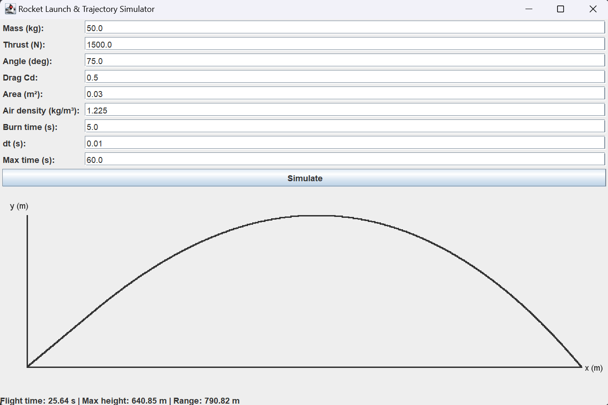

Overview

This project is a 2D rocket launch and trajectory simulator built in Java, focused on modeling real-world physics and responsive software design. It simulates rocket motion under thrust, drag, and gravity using Heun’s (Improved Euler) method, and visualizes trajectories through a Swing-based GUI.
The simulation runs on a background thread to keep the interface responsive. After it finishes, the application plots the trajectory and displays flight time, maximum height, and horizontal range.


Features
- 2D simulation of rocket motion with thrust, drag, and gravity

- Numerical integration using Heun’s (Improved Euler) method

- Adjustable simulation parameters (mass, thrust, angle, drag coefficient, time step, etc.)

- Multithreaded simulation to keep the GUI responsive.

- Trajectory plotting with automatically scaled axes.

- Includes a JUnit 5 test that checks gravitational acceleration when thrust and drag are disabled.

## Running the application

Install a Java Development Kit (JDK) and ensure `java` and `javac` are available in your terminal.

Download or clone this repository, then open a terminal in its root folder.

Compile the application:

```sh
javac -d out src/*.java
```

Launch it:

```sh
java -cp out RocketSimulatorApp
```

In the application, keep the default parameters and click **Simulate**. The completed trajectory will appear alongside flight time, maximum height, and horizontal range.

These commands compile the application only. The test in `test/RocketSimulatorTest.java` requires JUnit 5.
